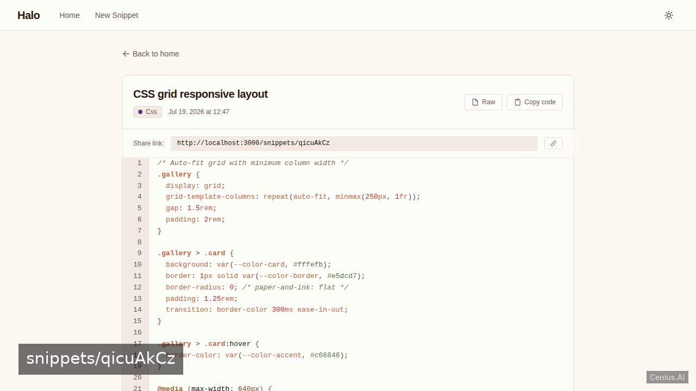
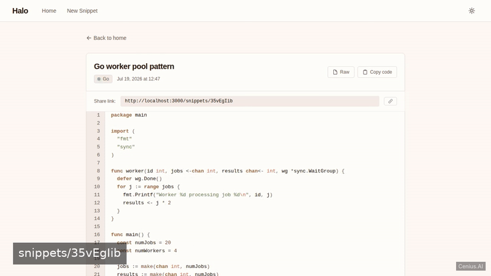
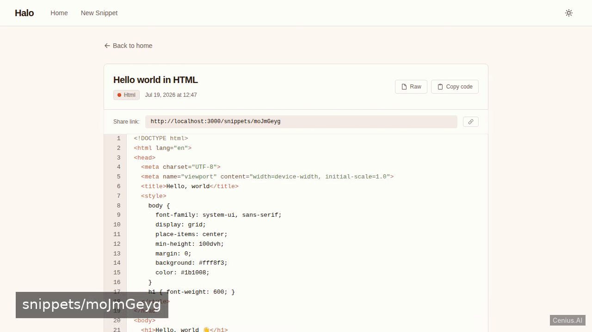
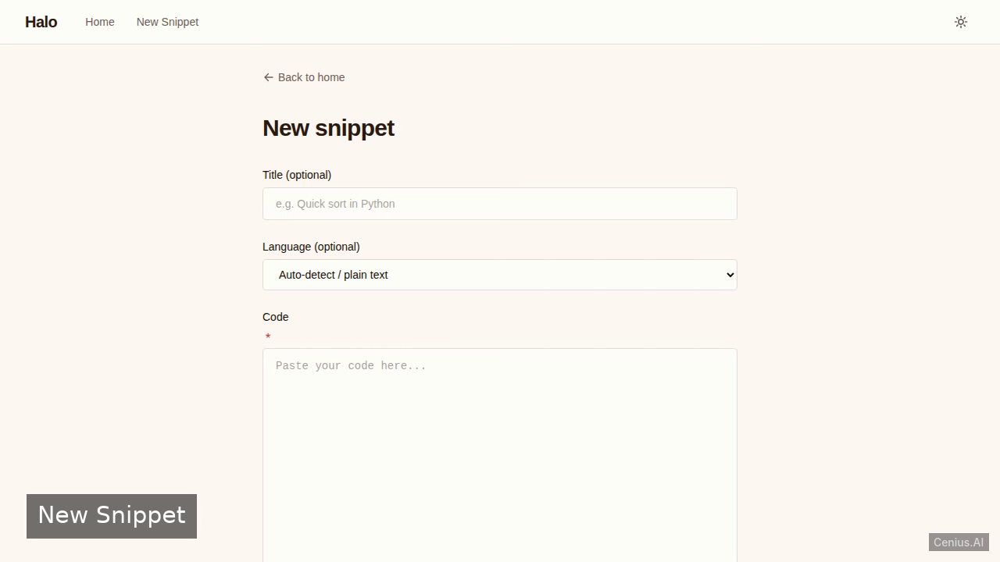

# Halo — Code Snippet Manager — complete Ruby on Rails pet web application example app

**Halo — Code Snippet Manager** gives you two paths: self-host the Apache-2.0-licensed Ruby on Rails source as your own web application, or [open it on cenius.ai](https://cenius.ai/marketplace/p/halo-code-snippet-manager?ref=gh&utm_campaign=halo-code-snippet-manager-rails), describe the changes you want, and receive a new Halo — Code Snippet Manager build with full rebrand rights. A developer‑focused pastebin built with Ruby on Rails. Everything ships in this repo — no paywall, no hidden features, no separate Halo — Code Snippet Manager download.


[](LICENSE)  [](https://cenius.ai)

[](https://cenius.ai/marketplace/p/halo-code-snippet-manager?ref=gh&utm_campaign=halo-code-snippet-manager-rails)

> **▶ [Open & edit in cenius.ai](https://cenius.ai/marketplace/p/halo-code-snippet-manager?ref=gh&utm_campaign=halo-code-snippet-manager-rails)** — one click to an editable workspace: describe changes in plain English, get an instant preview, one-click deploy and host. Modifications made on the platform come with full rebrand & relicense rights.

_Local clone? See [Quick start](#quick-start) below. cenius.ai is the zero-setup path._

## Demo





▶ **[Video walkthrough](https://cenius.ai/marketplace/p/halo-code-snippet-manager?ref=gh&utm_campaign=halo-code-snippet-manager-rails)** — see the app in action on the cenius.ai project page · [MP4 file](.github/media/demo.mp4)

## Screenshots

  

## Quick start

```bash
./install.sh   # installs dependencies + seeds demo data
```

See [`INSTALL.md`](INSTALL.md) for full setup and usage instructions.

## Usage guide

Once the development server is running (`bin/rails server`), open your browser to [http://localhost:3000](http://localhost:3000).

### Home Page
The home page (`/`) displays a list of existing snippets (if any are present in the database). From here you can click on a snippet to view its details.

### Creating a New Snippet
Navigate to `/snippets/new` (or click the “New Snippet” button on the home page). Fill in:
- **Title** – a descriptive name for the snippet
- **Language** – the programming language (e.g., `ruby`, `python`, `javascript`) for syntax highlighting
- **Code** – the actual code content

Click “Create Snippet”. You will be redirected to the newly created snippet’s page.

### Viewing a Snippet
Each snippet has its own page at `/snippets/:id`. The page shows:
- Syntax‑highlighted code (powered by Rouge)
- Copy button (click to copy code to clipboard)
- Shareable URL (use this link to share with others)

### Dark Mode
Toggle between light and dark themes using the theme switcher (a sun/moon icon in the navigation bar). Your preference is persisted in local storage.

### Demo Data
To populate the database with sample snippets, run:
```bash
bin/rails db:seed
```
Refresh the home page to see the demo snippets.

_Full guide: [`USAGE.md`](USAGE.md)_

## Features

- Anonymous snippet creation
- Snippet view with syntax highlighting
- Shareable link with copy button
- Recent snippets feed
- Raw content view
- Seeded demo data
- Dark/light mode toggle
- Responsive design

## Architecture

Everything runs out of the box: a Ruby on Rails codebase (2,225 files). `install.sh` provisions dependencies and seeds demo data so the app starts with something real to explore. Top-level layout: `app/`, `bin/`, `config/`, `db/`, `lib/`, `log/`, `public/`, `storage/`. Full setup details: [`INSTALL.md`](INSTALL.md).

## FAQ

### What does it take to self-host Halo — Code Snippet Manager?

`git clone` + `./install.sh` gets you a running instance — the install script provisions dependencies and demo data. Full steps live in [`INSTALL.md`](INSTALL.md); nothing external is needed to try it.

### Is white-labeling Halo — Code Snippet Manager allowed?

Yes — and the easiest way is [remixing it on cenius.ai](https://cenius.ai/marketplace/p/halo-code-snippet-manager?ref=gh&utm_campaign=halo-code-snippet-manager-rails): modifications made on the platform come with full rebrand and relicense rights over your derivative.

### How is Halo — Code Snippet Manager built technically?

Ruby on Rails end-to-end. Every file you need to run the app is here in this repository — code, configuration, seed data. Highlights include shareable link with copy button.

### What if I want to add features to Halo — Code Snippet Manager without coding?

Yes — [load it on cenius.ai](https://cenius.ai/marketplace/p/halo-code-snippet-manager?ref=gh&utm_campaign=halo-code-snippet-manager-rails), describe the change in plain English, and you get back a fresh build with your modification applied.

### Can I build a business on Halo — Code Snippet Manager?

It is. Apache-2.0 licensing means you can build a product on it, sell it, or use it inside a company with no fees. Details: [LICENSE](LICENSE).

## License & rebranding

Released under the [Apache License 2.0](LICENSE) (© 2026 Cenius AI) — free for personal and commercial use. The Cenius name/logo are trademarks (see NOTICE).

**Need a customized version?** [Remix this app on cenius.ai](https://cenius.ai/marketplace/p/halo-code-snippet-manager?ref=gh&utm_campaign=halo-code-snippet-manager-rails) — modifications made on the platform come with **full rebrand & relicense rights** over your derivative.

## Built with cenius.ai

This entire application — code, design, seeded demo data — was generated on **[cenius.ai](https://cenius.ai)** from a plain-English description.

- 🚀 [Build your own app on cenius.ai](https://cenius.ai)
- 🎛️ [Remix Halo — Code Snippet Manager on the marketplace](https://cenius.ai/marketplace/p/halo-code-snippet-manager?ref=gh&utm_campaign=halo-code-snippet-manager-rails) — open it in a workspace, prompt for changes, and ship your own version.

More open-source apps: [the Cenius-ai catalog](https://github.com/Cenius-ai) · [showcase index](https://github.com/Cenius-ai/showcase)
